  

  
  

## 👩‍💻 About me

I'm a **Software Engineer** and **Full-Stack Developer** who builds products end to end, from system design and clean APIs to polished, accessible interfaces.

I care about the whole lifecycle: understanding the problem, designing the architecture, writing maintainable code, and shipping it to real users.

- **End-to-end ownership:** from idea and UX to backend, deployment, and iteration
- **Clean architecture:** modular, readable code that's built to scale
- **Responsible AI:** integrating AI that is safe, verifiable, and genuinely useful
- **Bilingual products:** Arabic & English experiences with first-class RTL support

> Currently building products that make a real difference in people's lives.

## ✨ Featured projects

<table>
  <tr>
    <td width="50%" valign="top">
      
      <h3>🌿 Tamaninah | طمأنينة</h3>
      
Every experience can be a beginning for discovering Islam. Write what you feel in your own words, and get a short journey: a verse, its tafsir, an authentic hadith, a story from the Seerah, and a practical step.

      
<b>AI organizes, never authors:</b> every text is quoted verbatim from its verified source.

      <a href="https://tamaninah.netlify.app"><b>Live demo →</b></a> &nbsp;·&nbsp;
      <a href="https://github.com/YaraAbdulrahim/Tamaninah-Showcase">Repo</a>
    </td>
    <td width="50%" valign="top">
      
      <h3>🦅 Rafeeq | رفيق</h3>
      
A safe YouTube for kids (5–12). An AI "smart cut" removes only the inappropriate <i>moment</i>, not the whole video, and turns each cut into a conversation between parents and their children.

      
<b>Protects without depriving.</b>

      <a href="https://rafeeq-pi.vercel.app"><b>Live demo →</b></a> &nbsp;·&nbsp;
      <a href="https://github.com/YaraAbdulrahim/rafeeq">Repo</a>
    </td>
  </tr>
</table>

## 🧩 More things I've built

| Project | What it is | Stack |
|---|---|---|
| [**Meen Qadha**](https://github.com/YaraAbdulrahim/meengaddha) | Game homepage, designed end-to-end in Figma, then built | React · Tailwind · Figma |
| [**Weather App**](https://github.com/YaraAbdulrahim/Weather-App) | Real-time weather with an interactive video background | React · Vite · Tailwind |
| [**SpinIt**](https://github.com/YaraAbdulrahim/SpinIt) | Animated roulette wheel for quick decisions | React · Tailwind |
| [**Blog Website**](https://github.com/YaraAbdulrahim/BlogWebsite) | Full blog with users, posts, comments & admin panel | Django · Python |
| [**Book Review API**](https://github.com/YaraAbdulrahim/book-review-api) | REST API for books and reviews | Python |
| [**Contact Form**](https://github.com/YaraAbdulrahim/Contact-Form) | Validated, accessible form with clean components | React · Tailwind |

## 🛠️ Tech stack

  

